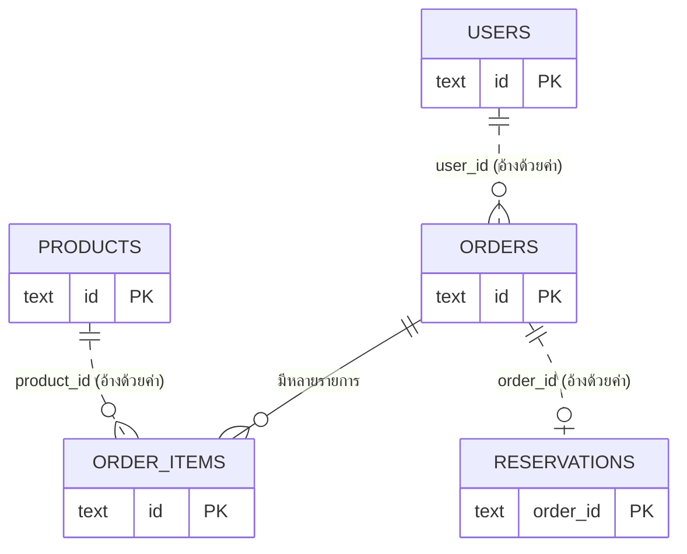
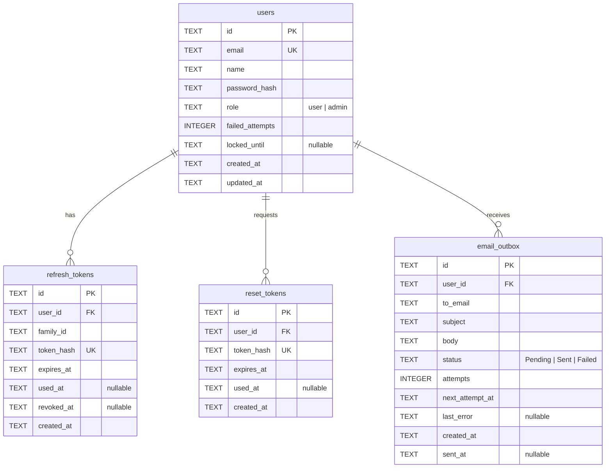
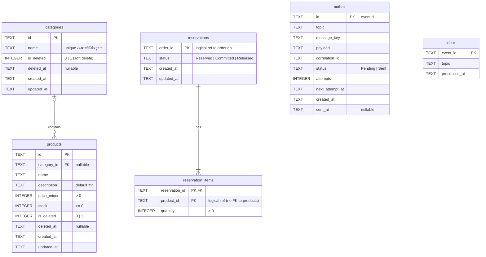
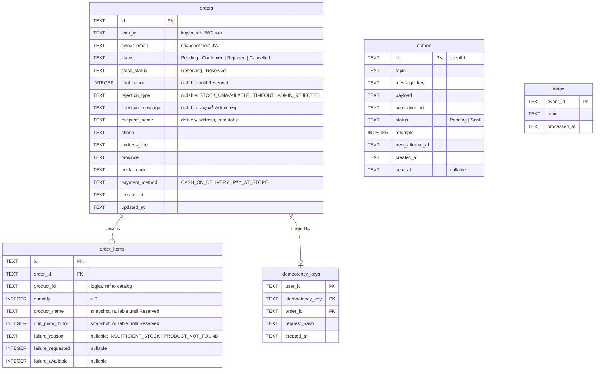

# ER Diagram

แต่ละบริการมีฐานข้อมูล SQLite ของตนเอง จึงไม่มี foreign key ข้ามบริการ การอ้างอิงข้ามบริการเก็บเป็นค่า id ธรรมดา (เส้นประในแผนภาพแรก) และรักษาความสอดคล้องด้วย Kafka event

## 1. ภาพรวมข้ามบริการ

| บริการ | ตารางหลัก |
|---|---|
| Auth (`auth.db`) | `users` |
| Catalog (`catalog.db`) | `products`, `reservations` |
| Order (`order.db`) | `orders`, `order_items` |

## 2. Auth Service (`auth.db`)

## 3. Catalog Service (`catalog.db`)

ตาราง `outbox` และ `inbox` ไม่ผูกกับตารางอื่น ใช้เก็บ event ที่รอส่งและ event ที่ประมวลผลแล้วเพื่อกันการทำซ้ำ

การลบหมวดหมู่เป็น soft delete (`is_deleted`) และสินค้าในหมวดนั้นจะมี `category_id` เป็นค่าว่าง ไม่ถูกลบตาม

## 4. Order Service (`order.db`)

คำสั่งซื้อที่ถูกปฏิเสธเก็บเหตุผลไว้ที่ `rejection_type` และ `rejection_message` ส่วนเหตุผลรายสินค้า (สต็อกไม่พอหรือไม่พบสินค้า) เก็บใน `order_items.failure_*`

ชื่อและราคาสินค้าใน `order_items` เป็นสำเนา ณ เวลาที่สั่ง จึงไม่เปลี่ยนตามการแก้ไขหรือลบสินค้าใน Catalog
