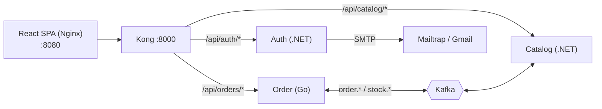

# Distributed Product Management System

ระบบจัดการสินค้าและคำสั่งซื้อแบบ Distributed System: แต่ละบริการแยกกัน มีฐานข้อมูล SQLite ของตนเอง และคุยกันผ่าน Kafka เท่านั้น

| ส่วนของระบบ | เทคโนโลยี |
|---|---|
| Frontend | React SPA, TypeScript, Vite, MUI (เสิร์ฟด้วย Nginx) |
| API Gateway | Kong (DB-less) |
| Auth / Catalog Service | .NET 10 Web API |
| Order Service | Go + Fiber |
| ส่งข้อความระหว่างบริการ | Apache Kafka (KRaft, JSON) |
| ฐานข้อมูล | SQLite แยกไฟล์ตามบริการ |
| รันระบบ | Docker Compose |

---

## 1. ติดตั้งและเริ่มระบบ

### ขั้นที่ 1 ติดตั้งโปรแกรมที่จำเป็น

- **Git**
- **Docker Desktop** (รวม Docker Compose แล้ว) และเปิดให้ทำงานอยู่ก่อนเริ่ม
- **OpenSSL** สำหรับสร้างกุญแจ JWT (ผู้ใช้ Windows ใช้ตัวที่มากับ Git Bash)

ผู้ใช้ Windows ให้พิมพ์คำสั่งทั้งหมดใน **Git Bash** ตรวจด้วย

```bash
git --version && docker compose version && openssl version
```

พอร์ตที่ต้องว่าง: `8000` (Kong), `8080` (หน้าเว็บ), `9092` (Kafka)

### ขั้นที่ 2 ดาวน์โหลดโค้ด

```bash
git clone git@github.com:kitsada8621/distributed-product-management.git
cd distributed-product-management
```

คำสั่งหลังจากนี้ทั้งหมดพิมพ์ในโฟลเดอร์นี้ (โฟลเดอร์ที่มี `docker-compose.yml`)

### ขั้นที่ 3 สร้างกุญแจ JWT

ไฟล์ `.pem` ไม่ถูกเก็บใน Git ต้องสร้างเองหนึ่งครั้ง (ข้ามได้หาก `auth-service/keys/` มี `jwt-private.pem` และ `jwt-public.pem` อยู่แล้ว)

```bash
openssl genpkey -algorithm RSA -pkeyopt rsa_keygen_bits:2048 -out auth-service/keys/jwt-private.pem
openssl rsa -in auth-service/keys/jwt-private.pem -pubout -out auth-service/keys/jwt-public.pem
```

### ขั้นที่ 4 สร้างไฟล์ `.env` จากไฟล์ตัวอย่าง

ไฟล์ `.env` ไม่ถูกเก็บใน Git ให้คัดลอกจาก `.env.example` ในโฟลเดอร์ที่ใช้งาน

| ไฟล์ตัวอย่าง | สร้างเป็น | ใช้เมื่อ |
|---|---|---|
| `.env.example` | `.env` | **จำเป็น** สำหรับรันด้วย Docker Compose |
| `frontend/.env.example` | `frontend/.env` | รันหน้าเว็บนอก Docker (`npm run dev`) |
| `order-service/.env.example` | `order-service/.env` | รัน Order Service นอก Docker |

```bash
cp .env.example .env
cp frontend/.env.example frontend/.env
cp order-service/.env.example order-service/.env
```

ถ้ารันทั้งระบบด้วย Docker อย่างเดียว ใช้แค่ไฟล์แรกก็พอ แล้วแก้ค่าใน `.env` ดังนี้

| ตัวแปร | ต้องทำอะไร |
|---|---|
| `CSRF_SECRET` | เปลี่ยนเป็นข้อความสุ่มยาวอย่างน้อย 32 ตัวอักษร หรือใช้คำสั่ง `openssl rand -base64 32` |
| `SPA_ORIGIN` | ต้องตรงกับที่อยู่ที่เปิดหน้าเว็บ ค่าเริ่มต้น `http://localhost:8080` ถ้าผิด refresh token และ logout จะไม่ทำงาน |
| `RESET_LINK_BASE_URL` | **เปลี่ยนเป็น `http://localhost:8080/reset-password`** (ค่าในตัวอย่างชี้พอร์ต 5173 ของ `npm run dev`) |
| `SEED_ADMIN_EMAIL` / `SEED_ADMIN_PASSWORD` | อีเมลและรหัสผ่านของ Admin คนแรก |
| `SMTP_*` | ใช้เฉพาะอีเมลลืมรหัสผ่าน ใส่ค่าจาก Mailtrap หรือ Gmail หรือปล่อย `SMTP_HOST` ว่างเพื่อไม่ส่งอีเมล ส่วนอื่นใช้งานได้ปกติ |

อย่านำรหัสผ่านจริงใส่ในไฟล์ `.env.example` หรือ commit ไฟล์ `.env`

### ขั้นที่ 5 เริ่มระบบ

```bash
docker compose up -d --build
```

ครั้งแรกใช้เวลาประมาณ 5 ถึง 15 นาที จากนั้นตรวจสถานะ ทุก container ต้องเป็น `running` และ `kafka` เป็น `healthy`

```bash
docker compose ps
```

### ขั้นที่ 6 ตรวจว่าพร้อมใช้งาน

รอ 30 ถึง 60 วินาที แล้วเรียก

```bash
curl http://localhost:8000/api/auth/health
curl http://localhost:8000/api/catalog/health
curl http://localhost:8000/api/orders/health
```

ทุกคำสั่งต้องตอบ `"success":true` (ถ้าได้ `502` ให้รอสักครู่แล้วลองใหม่)

### ขั้นที่ 7 เปิดใช้งาน

เปิด **http://localhost:8080** (ใช้ชื่อ `localhost` ไม่ใช้เลข IP เพราะคุกกี้ของระบบอาศัย `localhost`)

| บทบาท | บัญชี |
|---|---|
| Admin | อีเมลและรหัสผ่านที่ตั้งใน `SEED_ADMIN_*` ของ `.env` |
| User | สมัครเองที่หน้า Register |

ลองใช้งาน: Admin สร้างหมวดหมู่และสินค้าพร้อมสต็อก → สมัครและเข้าสู่ระบบเป็น User → สั่งซื้อ (สถานะ Pending แล้วเปลี่ยนเป็นผลการจองสต็อกในไม่กี่วินาที) → Admin ยืนยันหรือปฏิเสธ

### คำสั่งที่ใช้บ่อย

```bash
docker compose logs -f <ชื่อบริการ>   # ดู log เช่น auth-service
docker compose down                   # หยุดระบบ (เก็บข้อมูลไว้)
docker compose down -v                # หยุดและลบข้อมูลทั้งหมด
bash tests/api/run-all.sh             # ทดสอบ API ผ่าน Kong (ต้องรันระบบอยู่)
```

### แก้ปัญหาเบื้องต้น

| อาการ | วิธีแก้ |
|---|---|
| `docker compose up` ล้มเหลวเรื่อง secret หรือไฟล์ `.pem` | ทำขั้นที่ 3 ให้ครบ |
| `variable is not set` | ยังไม่ได้ทำขั้นที่ 4 หรือไม่ได้อยู่ในโฟลเดอร์ที่มี `docker-compose.yml` |
| พอร์ตถูกใช้อยู่ | ปิดโปรแกรมที่ใช้พอร์ต 8000, 8080 หรือ 9092 |
| login ได้แต่หลุดทันที/refresh ไม่ทำงาน | `SPA_ORIGIN` ไม่ตรงกับที่อยู่ในเบราว์เซอร์ |
| Order หรือ Catalog ตอบ `502` | Kafka ยังไม่พร้อม รอแล้วดู `docker compose logs kafka` |

---

## 2. รันแยกบริการเพื่อพัฒนา (ไม่บังคับ)

เปิด Kafka และบริการอื่นด้วย Docker ก่อน (`docker compose up -d`) แล้วหยุดเฉพาะบริการที่จะรันเอง เช่น `docker compose stop frontend`

**Frontend** (Node.js ที่ติดตั้ง `npm`)

```bash
cd frontend
cp .env.example .env     # VITE_API_BASE_URL = ที่อยู่ Kong (http://localhost:8000)
npm install
npm run dev              # เปิด http://localhost:5173
```

`npm run dev` ใช้พอร์ต 5173 จึงต้องตั้ง `SPA_ORIGIN=http://localhost:5173` ใน `.env` ของรากโปรเจกต์ แล้ว `docker compose up -d auth-service` ใหม่ (Kong ต้องอนุญาต CORS ของพอร์ตนี้ใน `kong/kong.yml`)

**Order Service** (Go)

```bash
cd order-service
cp .env.example .env
```

แก้ค่าใน `.env` ให้ตรงกับเครื่องที่รัน

| ตัวแปร | ค่า |
|---|---|
| `JWT_PUBLIC_KEY_PATH` | `../auth-service/keys/jwt-public.pem` |
| `KAFKA_BROKERS` | `localhost:9092` (พอร์ตที่ Compose เปิดให้ภายนอก; `localhost:29092` ในตัวอย่างใช้ได้เฉพาะภายใน Docker) |
| `HTTP_ADDR` | ใช้ `:8080` ชนกับหน้าเว็บ ให้หยุด `frontend` ก่อนหรือเปลี่ยนพอร์ต |

บริการอ่านค่าจาก environment variable ไม่โหลดไฟล์ `.env` เอง จึงต้อง export ก่อนรัน

```bash
set -a && source .env && set +a
go run ./cmd/api
```

---

## 3. ภาพรวมระบบ



- **Kong** ส่งต่อคำขอ จัดการ CORS ใส่ `X-Correlation-Id` และจำกัด rate limit แต่ไม่ตรวจ JWT
- **Auth** ออก JWT ด้วย private key ส่วน Catalog และ Order ตรวจลายเซ็นเองด้วย public key
- **Catalog** จัดการสินค้า หมวดหมู่ สต็อก ตัดสต็อกเมื่อได้ `order.created` แล้วตอบ `stock.reserved` หรือ `stock.rejected`
- **Order** บันทึกคำสั่งซื้อสถานะ Pending ตอบ `202` ทันที แล้วรอผลสต็อก Admin ยืนยันหรือปฏิเสธ ผู้ใช้ยกเลิกได้เฉพาะตอน Pending ถ้าไม่ได้ผลสต็อกใน 60 วินาที ระบบปฏิเสธและคืนสต็อกเอง

แผนภาพละเอียด: [Sequence-Diagram.md](Sequence-Diagram.md) (ลำดับการทำงานตั้งแต่ login ถึง Admin ยืนยันคำสั่งซื้อ) และ [ER-Diagram.md](ER-Diagram.md) (ตารางของแต่ละบริการ)

## 4. โครงสร้างโฟลเดอร์

โครงสร้างระดับบนสุดของ `distributed-product-management`

```text
distributed-product-management/
├── docker-compose.yml   # Kafka, Auth, Catalog, Order, Kong, Frontend
├── .env.example         # ตัวอย่างค่าตั้งค่าของ Compose (คัดลอกเป็น .env)
├── global.json          # กำหนดเวอร์ชัน .NET SDK
├── kong/kong.yml        # เส้นทาง, CORS, correlation id, rate limit
├── auth-service/        # .NET 10 (Clean Architecture)
├── catalog-service/     # .NET 10 (Clean Architecture)
├── order-service/       # Go (Clean Architecture)
├── frontend/            # React (Feature-Based)
└── tests/api/           # สคริปต์ทดสอบ API ด้วย bash และ curl
```

### 4.1 Clean Architecture: auth-service (.NET)

แบ่งเป็น 4 โปรเจกต์ โดยโปรเจกต์ชั้นนอกเรียกใช้ชั้นใน ไม่เรียกย้อนกลับ ลำดับจากในสุดไปนอกสุดคือ Domain, Application, Infrastructure และ Api

```text
auth-service/
├── Dockerfile                          # สร้าง image ของบริการนี้
├── AuthService.slnx                    # ไฟล์ solution รวมทุกโปรเจกต์
├── keys/                               # กุญแจลงนาม JWT (ไฟล์ .pem ไม่ถูกเก็บใน Git ต้องสร้างเอง)
├── src/
│   ├── Auth.Domain/                    # ชั้นแกนกลาง: เนื้อหาธุรกิจล้วน ไม่พึ่งเครื่องมือภายนอก
│   │   ├── Users/                      # ผู้ใช้และ role (User, Admin)
│   │   ├── Tokens/                     # refresh token และ reset token
│   │   └── Emails/                     # รายการอีเมลที่รอส่ง (email outbox) และสถานะ
│   ├── Auth.Application/               # ชั้น use case และ interface ที่ต้องการ
│   │   ├── Users/                      # สมัครสมาชิก, login, ลืม/รีเซ็ตรหัสผ่าน, ดูข้อมูลตนเอง
│   │   ├── Tokens/                     # ต่ออายุ token (refresh) และ logout
│   │   ├── Emails/                     # ส่งอีเมลที่ค้างอยู่ใน outbox
│   │   ├── Security/                   # interface ของการเข้ารหัสผ่านและการออก token
│   │   └── Common/                     # exception, รหัส error และข้อมูลที่ใช้ร่วมกัน
│   ├── Auth.Infrastructure/            # ชั้นเชื่อมระบบภายนอก: ทำตาม interface ที่ Application กำหนด
│   │   ├── Persistence/                # SQLite: DbContext, repository, migration, สร้าง Admin เริ่มต้น
│   │   ├── Security/                   # เข้ารหัสผ่านด้วย Argon2, ออก JWT, อ่านกุญแจ RSA
│   │   └── Email/                      # ส่งอีเมลผ่าน SMTP
│   └── Auth.Api/                       # ชั้นทางเข้า: รับ HTTP request แล้วส่งต่อให้ use case
│       ├── Program.cs                  # จุดเริ่มโปรแกรม ประกอบ (wire) ทุกชั้นเข้าด้วยกัน
│       ├── Endpoints/                  # register, login, refresh, logout, health
│       ├── Common/                     # รูปแบบ response, จัดการ error, correlation id, คุกกี้, ตรวจ CSRF/Origin
│       ├── Workers/                    # งานเบื้องหลังที่วนส่งอีเมลจาก outbox
│       └── appsettings.json            # ค่าตั้งต้นของบริการ
└── tests/
    ├── Auth.UnitTests/                 # ทดสอบกฎธุรกิจและ use case โดยไม่ใช้ฐานข้อมูลจริง
    └── Auth.IntegrationTests/          # ทดสอบ endpoint, ฐานข้อมูล และ worker แบบทำงานจริง
```

### 4.2 Clean Architecture: catalog-service (.NET)

ใช้โครงสร้างเดียวกับ auth-service ต่างกันที่เนื้อหาธุรกิจและส่วนเชื่อม Kafka

```text
catalog-service/
├── Dockerfile
├── CatalogService.slnx
├── scripts/
│   └── smoke-events.sh                 # ทดสอบเส้นทาง event ของ Catalog กับระบบที่รันอยู่
├── src/
│   ├── Catalog.Domain/                 # สินค้า, หมวดหมู่, การจองสต็อก (reservation), inbox/outbox message
│   ├── Catalog.Application/            # use case: จัดการสินค้า/หมวดหมู่/สต็อก, จองสต็อก, ยืนยัน, คืนสต็อก
│   │   ├── Events/                     # ชื่อ topic และรูปแบบ event ที่รับและส่ง
│   │   └── Messaging/                  # ส่ง event ที่ค้าง, ส่งไป dead letter queue เมื่อประมวลผลไม่ได้
│   ├── Catalog.Infrastructure/
│   │   ├── Persistence/                # SQLite, repository, migration
│   │   ├── Kafka/                      # ตัวส่ง event และสร้าง topic เริ่มต้น
│   │   └── Security/                   # อ่าน public key เพื่อตรวจ JWT
│   └── Catalog.Api/
│       ├── Endpoints/                  # API ของสินค้าและหมวดหมู่
│       └── Workers/                    # รับ event จาก Order และส่ง outbox ไป Kafka
└── tests/                              # unit test และ integration test
```

### 4.3 Clean Architecture: order-service (Go)

จัดชั้นแบบเดียวกัน คือ `domain` อยู่ในสุด ถัดมาเป็น `usecase` และชั้นนอกเป็น `delivery` กับ `infrastructure` โดยชั้นนอกเรียกชั้นใน ไม่เรียกย้อนกลับ

```text
order-service/
├── cmd/
│   └── api/
│       ├── main.go                     # รับสัญญาณปิดโปรแกรมแล้วเรียก run
│       └── run.go                      # ประกอบ (wire) ทุกชั้น: ฐานข้อมูล, Kafka, worker, HTTP
├── internal/                           # โค้ดหลักของบริการ (Go ไม่ให้โปรเจกต์อื่น import)
│   ├── domain/                         # คำสั่งซื้อ, กฎยกเลิก/ยืนยัน/ปฏิเสธ, error และ interface ของฐานข้อมูล
│   │   └── event/                      # รูปแบบ event และ interface สำหรับส่ง event
│   ├── usecase/                        # สร้างคำสั่งซื้อ, ดูรายการ, ยกเลิก, Admin ยืนยัน/ปฏิเสธ,
│   │                                   #   รับผลสต็อก, ปฏิเสธเมื่อหมดเวลา (sweeper), ส่ง outbox ไป Kafka (relay)
│   ├── delivery/
│   │   ├── http/                       # Fiber
│   │   │   ├── handler/                # รับ request แปลงเป็นการเรียก use case
│   │   │   ├── middleware/             # correlation id, access log, ตรวจ JWT, ตรวจ role, จัดการ error
│   │   │   └── dto/                    # โครงสร้าง request/response และ envelope
│   │   └── kafka/                      # รับ message, แยกตาม topic, retry และส่ง dead letter
│   └── infrastructure/
│       ├── database/                   # เปิดการเชื่อมต่อ SQLite และรัน migration
│       ├── repository/                 # อ่าน/เขียนฐานข้อมูลจริง (GORM)
│       ├── kafka/                      # ตัวส่ง event และสร้าง topic
│       ├── token/                      # ตรวจลายเซ็น JWT (RS256)
│       └── worker/                     # ตัวทำงานวนตามเวลา สำหรับ sweeper และ relay
├── pkg/
│   └── correlation/                    # ตัวช่วยจัดการ correlation id (ไม่มีกฎธุรกิจ)
├── config/                             # อ่านค่าตั้งค่าจาก environment variable
├── migrations/                         # ไฟล์ SQL สร้างตาราง (Goose)
├── Dockerfile
├── .env.example                        # ตัวอย่างค่าตั้งค่า (คัดลอกเป็น .env)
├── go.mod
└── go.sum
```

การทดสอบของ Order เป็น unit test ของกฎธุรกิจใน `internal/domain` และ `internal/usecase` (ไฟล์ `*_test.go` อยู่ข้างไฟล์ที่ทดสอบ)

### 4.4 Feature-Based Architecture: frontend (React)

แยกโค้ดตามฟีเจอร์ธุรกิจ ไม่แยกตามชนิดไฟล์ โดยมีกฎว่า `app` เรียก `pages`, `pages` เรียก `features`, `features` เรียก `shared` เท่านั้น และ `shared` ห้ามเรียก `features`

```text
frontend/
├── Dockerfile                          # build หน้าเว็บแล้วเสิร์ฟด้วย Nginx
├── nginx.conf                          # ตั้งค่า Nginx ให้เสิร์ฟ SPA
├── package.json                        # dependency และคำสั่ง (npm run ...)
├── vite.config.ts                      # ตั้งค่า Vite
├── .env.example                        # VITE_API_BASE_URL (ที่อยู่ Kong) คัดลอกเป็น .env
├── public/                             # ไฟล์ static เช่น ฟอนต์
└── src/
    ├── main.tsx                        # จุดเริ่มโปรแกรม
    ├── App.tsx                         # คอมโพเนนต์แรกของแอป
    ├── app/                            # ส่วนประกอบระดับแอป
    │   ├── layouts/                    # โครงหน้า: แถบหัว, เมนูฝั่ง Admin
    │   ├── providers/                  # ตัวห่อแอปที่ให้ state กลาง (เช่น theme, session)
    │   ├── router/                     # ตารางเส้นทางหน้า และ guard ตรวจการเข้าสู่ระบบ/สิทธิ์
    │   └── theme.ts                    # ธีมและสีของ MUI
    ├── pages/                          # หน้าจอ ประกอบ feature เข้าด้วยกัน ห้ามเรียก API เอง
    │   ├── admin/                      # จัดการสินค้า, หมวดหมู่, คำสั่งซื้อทั้งหมด
    │   └── errors/                     # หน้า 401, 403, 404
    ├── features/                       # ฟีเจอร์ธุรกิจ แต่ละตัวมี api / components / hooks (ตามที่จำเป็น)
    │   ├── auth/                       # สมัคร, login, ลืม/รีเซ็ตรหัสผ่าน, เก็บสถานะการเข้าสู่ระบบ
    │   ├── products/                   # รายการและรายละเอียดสินค้า, ฟอร์มสินค้าของ Admin
    │   ├── categories/                 # จัดการหมวดหมู่
    │   ├── stock/                      # ปรับจำนวนสต็อก
    │   ├── orders/                     # สร้างคำสั่งซื้อ, ดูคำสั่งซื้อของตน, ยกเลิก, ติดตามสถานะ
    │   └── admin-orders/               # Admin ดูคำสั่งซื้อทั้งหมด, ยืนยัน, ปฏิเสธ
    ├── shared/                         # ของใช้ร่วมกัน ไม่รู้จักฟีเจอร์ใด
    │   ├── api/                        # HTTP client (แนบ token, ต่ออายุเมื่อ 401), แปลง error
    │   ├── config/                     # อ่านค่า environment และกำหนดชื่อเส้นทาง
    │   ├── hooks/                      # hook ทั่วไป เช่น แจ้งเตือน, แบ่งหน้า, หน่วงเวลาพิมพ์
    │   ├── lib/                        # ฟังก์ชันช่วย เช่น จัดรูปแบบเงินและวันที่
    │   └── ui/                         # ส่วนประกอบที่ใช้ซ้ำ เช่น ตาราง loading, ข้อความ error, แบ่งหน้า
    ├── mocks/                          # ข้อมูลจำลอง API (MSW) ใช้เฉพาะในเทสต์
    └── test/                           # ตัวช่วยและการตั้งค่าสำหรับ test
```

ไฟล์ test ของหน้าจอและฟีเจอร์อยู่ข้างไฟล์ที่ทดสอบ (ชื่อลงท้าย `.test.ts` หรือ `.test.tsx`)

