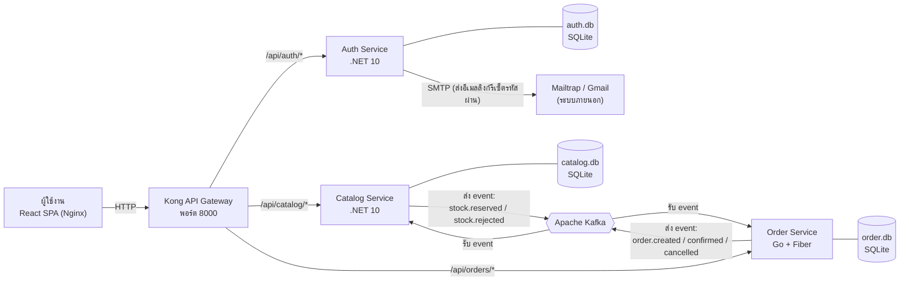
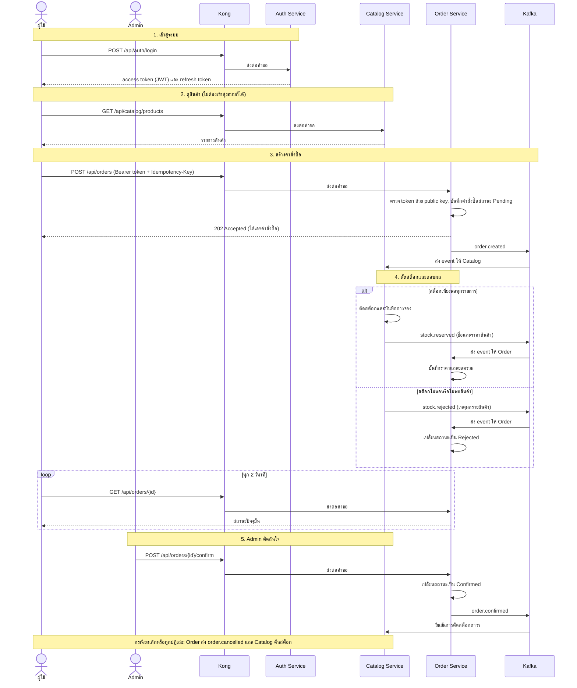
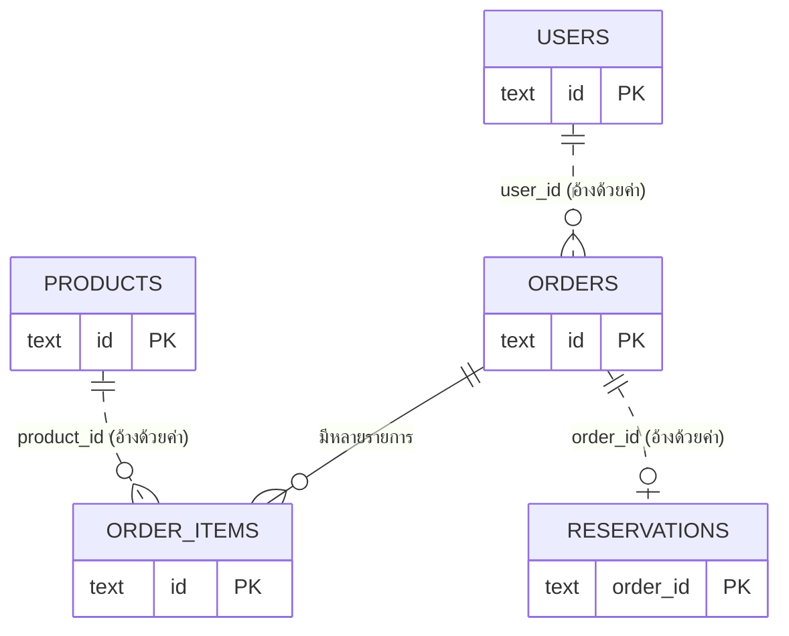
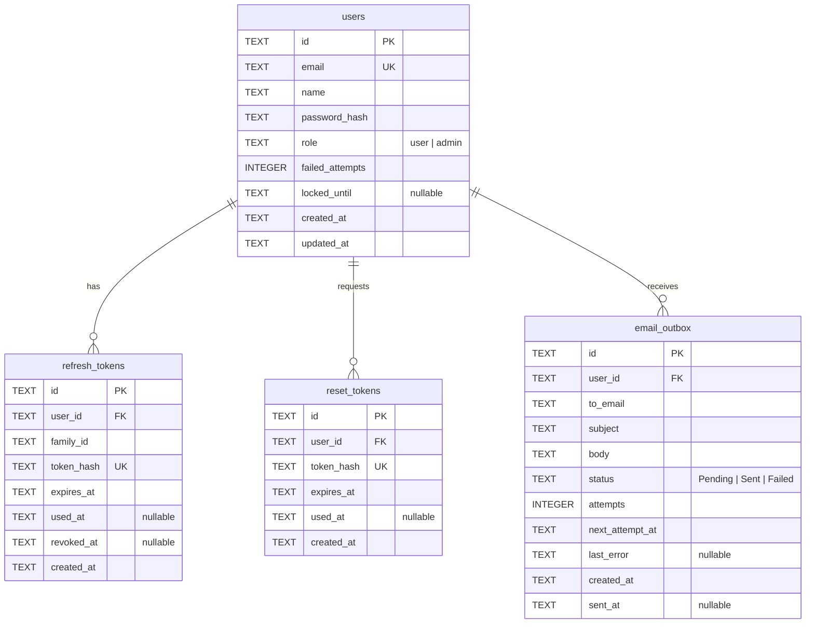
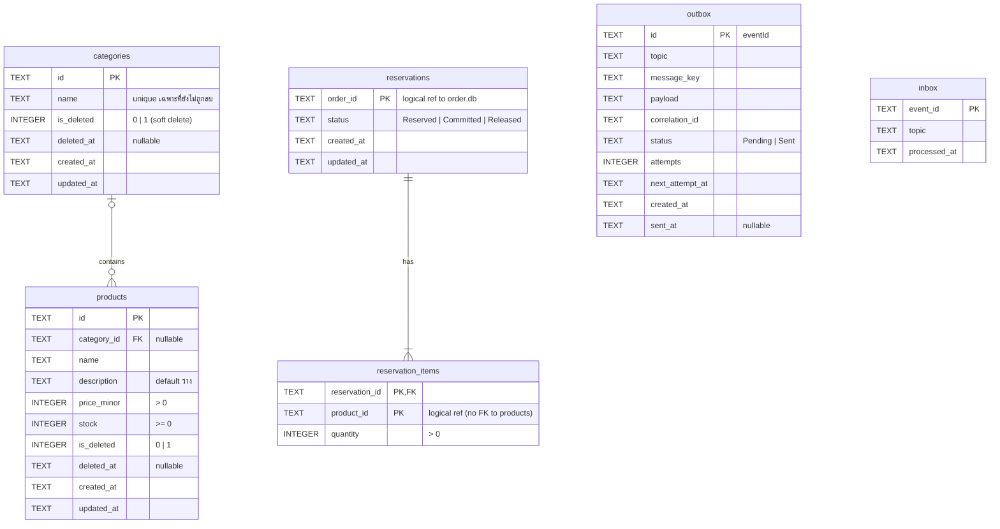
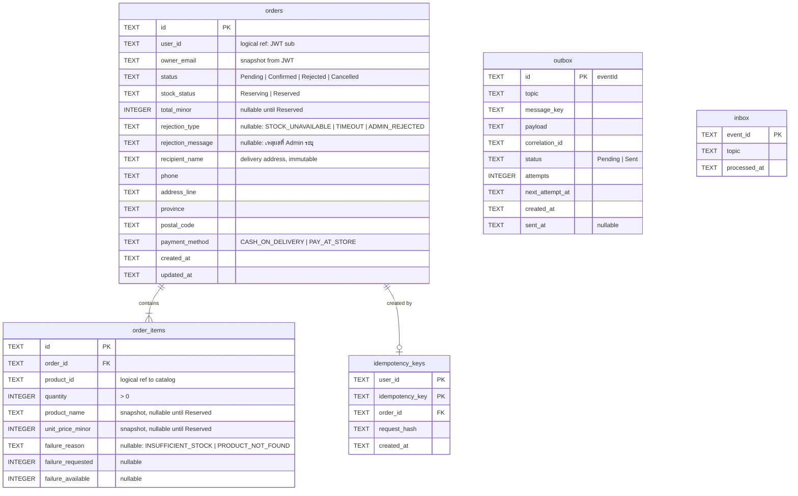

# Distributed Product Management System

ระบบจัดการสินค้าและคำสั่งซื้อแบบ Distributed System แยกเป็นบริการอิสระ 3 ตัว ได้แก่ Auth, Catalog และ Order โดยมี API Gateway เป็นทางเข้าเดียว และใช้ Apache Kafka เป็นช่องทางสื่อสารระหว่างบริการ ทุกส่วนรันผ่าน Docker Compose

## สารบัญ

1. [เทคโนโลยีที่ใช้](#1-เทคโนโลยีที่ใช้)
2. [ภาพรวมการทำงานของระบบ (System Flows)](#2-ภาพรวมการทำงานของระบบ-system-flows)
3. [เหตุผลการเลือกเทคโนโลยีและข้อแลกเปลี่ยน (Trade-off)](#3-เหตุผลการเลือกเทคโนโลยีและข้อแลกเปลี่ยน-trade-off)
4. [ER Diagram](#4-er-diagram)
5. [โครงสร้างโฟลเดอร์](#5-โครงสร้างโฟลเดอร์)
6. [ขั้นตอนการติดตั้งและเริ่มระบบ](#6-ขั้นตอนการติดตั้งและเริ่มระบบ)

---

## 1. เทคโนโลยีที่ใช้

| ส่วนของระบบ | เทคโนโลยี |
|---|---|
| Frontend | React (Single Page Application) เขียนด้วย TypeScript, สร้างด้วย Vite, ใช้ MUI เป็นชุดส่วนประกอบหน้าจอ, เสิร์ฟด้วย Nginx |
| API Gateway | Kong (โหมด DB-less) |
| Auth Service | .NET 10 Web API |
| Catalog Service | .NET 10 Web API |
| Order Service | Go (Fiber) |
| ช่องทางสื่อสารระหว่างบริการ | Apache Kafka (โหมด KRaft) ส่งข้อมูลรูปแบบ JSON |
| ฐานข้อมูล | SQLite แยกไฟล์ตามบริการ |
| การรันระบบ | Docker และ Docker Compose |

---

## 2. ภาพรวมการทำงานของระบบ (System Flows)

### 2.1 แผนภาพการเชื่อมต่อของระบบ



### 2.2 อธิบายการเชื่อมต่อ

**ผู้ใช้งานถึง Kong.** หน้าเว็บ (React) เรียก API ผ่าน Kong เพียงจุดเดียวที่พอร์ต 8000 Kong ทำหน้าที่ส่งต่อคำขอไปยังบริการที่เหมาะสมตามเส้นทาง (`/api/auth`, `/api/catalog`, `/api/orders`) จัดการ CORS ใส่ `X-Correlation-Id` ให้ทุกคำขอเพื่อใช้ไล่ log ข้ามบริการ และจำกัดจำนวนครั้งการ login ต่อ IP Kong ไม่ตรวจสอบ JWT แต่ละบริการตรวจสอบสิทธิ์ด้วยตนเอง

**Auth Service.** ดูแลการสมัครสมาชิก การเข้าสู่ระบบ การต่ออายุ token การออกจากระบบ และการลืมรหัสผ่าน บริการนี้ลงนาม access token ด้วย private key ส่วน Catalog และ Order ใช้ public key ตรวจลายเซ็นเอง จึงไม่ต้องเรียก Auth ทุกครั้งที่มีคำขอ Auth ส่งอีเมลรีเซ็ตรหัสผ่านผ่าน SMTP โดยตรง ไม่มีบริการแจ้งเตือนแยกต่างหาก

**Catalog Service.** ดูแลสินค้า หมวดหมู่ และจำนวนสต็อก ผู้ใช้ทั่วไปและผู้เยี่ยมชมดูสินค้าได้ ส่วนการเพิ่ม แก้ไข ลบสินค้าและปรับสต็อกเป็นสิทธิ์ของ Admin เมื่อได้รับ event `order.created` จะตัดสต็อกให้ (reserve) แล้วตอบกลับด้วย `stock.reserved` หรือ `stock.rejected`

**Order Service.** ดูแลคำสั่งซื้อ เมื่อผู้ใช้สร้างคำสั่งซื้อ บริการนี้บันทึกคำสั่งซื้อในสถานะ Pending แล้วส่ง `order.created` ไปยัง Kafka จากนั้นรอผลจาก Catalog Admin เป็นผู้ยืนยัน (Confirm) หรือปฏิเสธ (Reject) ส่วนผู้ใช้ยกเลิกได้เฉพาะคำสั่งซื้อที่ยังเป็น Pending

**Kafka.** เป็นช่องทางเดียวที่บริการต่างๆ ใช้คุยกัน ไม่มีบริการใดเรียกบริการอื่นโดยตรง และแต่ละบริการมีฐานข้อมูล SQLite ของตนเอง ไม่เข้าถึงข้อมูลของกัน

### 2.3 ลำดับการทำงานโดยรวม (Sequence Diagram)

แผนภาพนี้แสดงเส้นทางหลักของระบบ ตั้งแต่เข้าสู่ระบบ ดูสินค้า สั่งซื้อ จนถึง Admin ยืนยันคำสั่งซื้อ



**คำอธิบายขั้นตอน**

1. ผู้ใช้เข้าสู่ระบบกับ Auth Service และได้ token สำหรับใช้เรียกบริการอื่น
2. ผู้ใช้ดูสินค้าจาก Catalog ได้โดยไม่ต้องเข้าสู่ระบบ
3. เมื่อสั่งซื้อ Order Service บันทึกคำสั่งซื้อแล้วตอบกลับทันทีว่ารับเรื่องแล้ว (202) โดยยังไม่รู้ราคาหรือสต็อก เพราะไม่ได้เรียก Catalog โดยตรง
4. Catalog ได้รับ event ไปตัดสต็อก ถ้าสินค้าครบทุกรายการจึงสำเร็จ ถ้ารายการใดไม่พอ ทั้งคำสั่งซื้อจะถูกปฏิเสธ (all-or-nothing) หน้าเว็บสอบถามสถานะทุก 2 วินาทีจนกว่าจะได้ผล
5. Admin ยืนยันหรือปฏิเสธคำสั่งซื้อที่จองสต็อกสำเร็จแล้ว หากถูกปฏิเสธหรือผู้ใช้ยกเลิก ระบบคืนสต็อกให้อัตโนมัติ และหากไม่ได้รับผลจาก Catalog ภายใน 60 วินาที ระบบจะปฏิเสธคำสั่งซื้อนั้นเองและคืนสต็อก

---

## 3. เหตุผลการเลือกเทคโนโลยีและข้อแลกเปลี่ยน (Trade-off)

| เทคโนโลยี / แนวทาง | เหตุผลที่เลือก | สิ่งที่ได้ | สิ่งที่ต้องยอมรับ |
|---|---|---|---|
| แยกเป็น Microservices | โจทย์กำหนดให้แต่ละส่วนเป็นบริการอิสระ | แยกพัฒนา แยก deploy และแยกความรับผิดชอบได้ บริการหนึ่งล่มไม่ทำให้ทั้งระบบหยุด | ระบบซับซ้อนกว่าแอปเดียว ต้องดูแลหลาย container และต้องออกแบบการสื่อสารให้ดี |
| Kafka เป็นช่องทางสื่อสารระหว่างบริการ | ต้องการให้บริการไม่ผูกกันแบบ synchronous | หาก Catalog ล่มชั่วคราว Order ยังรับคำสั่งซื้อได้ เมื่อ Catalog กลับมาจึงประมวลผลต่อ event ไม่หาย | ผลลัพธ์ไม่ได้ทันที (eventual consistency) ผู้ใช้เห็นสถานะ Pending ก่อน และต้องออกแบบรับ event ซ้ำ |
| Transactional Outbox และ Inbox | Kafka ส่งแบบ at-least-once อาจซ้ำ และการบันทึกฐานข้อมูลกับการส่ง event ไม่อยู่ใน transaction เดียวกัน | บันทึกข้อมูลและ event ใน transaction เดียว จึงไม่สูญหาย ฝั่งรับตรวจ eventId ทำให้ไม่ตัดสต็อกซ้ำ | โค้ดและตารางเพิ่มขึ้น มี worker คอยส่ง event ซึ่งเพิ่มความหน่วงเล็กน้อย (ประมาณ 1 วินาที) |
| Kong แบบ DB-less | เป็นทางเข้าเดียว ตั้งค่าด้วยไฟล์เดียวและไม่ต้องมีฐานข้อมูลเพิ่ม | ติดตั้งง่าย ตั้งค่าอยู่ใน Git ตรวจสอบย้อนหลังได้ | แก้ค่าต้องแก้ไฟล์แล้วเริ่มใหม่ ไม่อ่านตัวแปร environment ในไฟล์ได้ และ rate limit เป็นค่าประมาณ |
| ตรวจ JWT ที่แต่ละบริการ (ไม่ตรวจที่ Kong) | ให้ทุกบริการปลอดภัยด้วยตนเอง แม้มีคนเรียกข้าม Gateway | ไม่ต้องไว้ใจชั้นนอกอย่างเดียว บริการตรวจ role และเจ้าของข้อมูลได้เอง | ทุกบริการต้องมีโค้ดตรวจ token ซ้ำกัน และ access token ที่ออกไปแล้วยังใช้ได้จนหมดอายุ (15 นาที) แม้ logout |
| JWT ลงนามแบบ RS256 (คู่กุญแจ) | บริการอื่นตรวจ token ได้โดยไม่ต้องเรียก Auth | ไม่มีการเรียกข้ามบริการตอนตรวจสิทธิ์ ไม่ต้องแชร์ความลับที่ใช้ลงนาม | ต้องสร้างและแจกจ่ายไฟล์กุญแจก่อนเริ่มระบบ |
| SQLite แยกต่อบริการ | เหมาะกับงานทดสอบ ติดตั้งไม่ต้องมีเซิร์ฟเวอร์ฐานข้อมูล และบังคับไม่ให้บริการแตะข้อมูลของกัน | เริ่มระบบเร็ว ใช้ทรัพยากรน้อย ย้ายหรือล้างข้อมูลง่าย (ไฟล์เดียวใน volume) | เขียนพร้อมกันได้จำกัด ขยายเป็นหลายเครื่องไม่ได้ ถ้าใช้งานจริงควรย้ายไป PostgreSQL |
| .NET 10 สำหรับ Auth และ Catalog | ระบบนิเวศครบสำหรับ Web API, ความปลอดภัย (JWT, hashing) และมีเครื่องมือจัดการฐานข้อมูลที่ดี | พัฒนาเร็วและมีโครงสร้างชัดเจน | image ใหญ่กว่า Go และใช้หน่วยความจำมากกว่า |
| Go (Fiber) สำหรับ Order | Order เป็นจุดรับ request จำนวนมากและต้องตอบเร็ว | ใช้ทรัพยากรน้อย เริ่มเร็ว ตอบเร็ว | ทีมต้องดูแลสองภาษา และโค้ดที่ใช้ร่วมกันไม่ได้ ต้องเขียนส่วนตรวจ JWT ซ้ำ |
| React SPA และ Vite | โจทย์ต้องการหน้าจอโต้ตอบกับ API และแยกจาก backend ชัดเจน | พัฒนาเร็ว แยก deploy ได้ เสิร์ฟเป็นไฟล์ static ผ่าน Nginx | โหลดครั้งแรกใช้ JavaScript มากกว่าหน้าที่ render ฝั่งเซิร์ฟเวอร์ และไม่เหมาะกับงานที่ต้องพึ่ง SEO |
| ตัดสต็อกตั้งแต่สร้างคำสั่งซื้อ | ป้องกันการขายเกินสต็อก (overselling) | สินค้าไม่ถูกขายซ้ำเมื่อมีหลายคนสั่งพร้อมกัน | สต็อกถูกกันไว้ระหว่างรอ Admin จึงต้องมีกลไกคืนสต็อกเมื่อยกเลิกหรือหมดเวลา |

---

## 4. ER Diagram

แต่ละบริการมีฐานข้อมูล SQLite ของตนเอง จึงไม่มี foreign key ข้ามบริการ การอ้างอิงข้ามบริการเก็บเป็นค่า id ธรรมดา (เส้นประในแผนภาพแรก) และรักษาความสอดคล้องด้วย Kafka event

### 4.1 ภาพรวมข้ามบริการ



| บริการ | ตารางหลัก |
|---|---|
| Auth (`auth.db`) | `users` |
| Catalog (`catalog.db`) | `products`, `reservations` |
| Order (`order.db`) | `orders`, `order_items` |

### 4.2 Auth Service (`auth.db`)



### 4.3 Catalog Service (`catalog.db`)



ตาราง `outbox` และ `inbox` ไม่ผูกกับตารางอื่น ใช้เก็บ event ที่รอส่งและ event ที่ประมวลผลแล้วเพื่อกันการทำซ้ำ

การลบหมวดหมู่เป็น soft delete (`is_deleted`) และสินค้าในหมวดนั้นจะมี `category_id` เป็นค่าว่าง ไม่ถูกลบตาม

### 4.4 Order Service (`order.db`)



คำสั่งซื้อที่ถูกปฏิเสธเก็บเหตุผลไว้ที่ `rejection_type` และ `rejection_message` ส่วนเหตุผลรายสินค้า (สต็อกไม่พอหรือไม่พบสินค้า) เก็บใน `order_items.failure_*`

ชื่อและราคาสินค้าใน `order_items` เป็นสำเนา ณ เวลาที่สั่ง จึงไม่เปลี่ยนตามการแก้ไขหรือลบสินค้าใน Catalog

---

## 5. โครงสร้างโฟลเดอร์

โครงสร้างระดับบนสุดของ `distributed-product-management`

```text
distributed-product-management/
├── docker-compose.yml           # ไฟล์รันระบบทั้งหมด: Kafka, Auth, Catalog, Order, Kong และ Frontend
├── .env                         # ค่าตั้งค่าที่ Compose อ่านตอนเริ่มระบบ (สร้างเองตามขั้นที่ 4 ในหัวข้อที่ 6)
├── global.json                  # กำหนดเวอร์ชัน .NET SDK ของโปรเจกต์
├── kong/
│   └── kong.yml                 # ตั้งค่า Gateway: เส้นทางของแต่ละบริการ, CORS, correlation id, rate limit
├── auth-service/                # บริการยืนยันตัวตน (.NET 10)
├── catalog-service/             # บริการสินค้าและสต็อก (.NET 10)
├── order-service/               # บริการคำสั่งซื้อ (Go)
├── frontend/                    # หน้าเว็บ (React)
└── tests/
    └── api/                     # ชุด script ทดสอบ API ผ่าน Kong ด้วย bash และ curl
```

### 5.1 auth-service (.NET)

แบ่งเป็น 4 โปรเจกต์ตามหลัก Clean Architecture โดยโปรเจกต์ชั้นนอกเรียกใช้ชั้นใน ไม่เรียกย้อนกลับ ลำดับจากในสุดไปนอกสุดคือ Domain, Application, Infrastructure และ Api

```text
auth-service/
├── Dockerfile                          # สร้าง image ของบริการนี้
├── AuthService.slnx                    # ไฟล์ solution รวมทุกโปรเจกต์
├── keys/                               # ที่เก็บกุญแจลงนาม JWT (ไฟล์ .pem ไม่ถูกเก็บใน Git ต้องสร้างเอง)
├── src/
│   ├── Auth.Domain/                    # ชั้นแกนกลาง: เนื้อหาธุรกิจล้วน ไม่พึ่งเครื่องมือภายนอก
│   │   ├── Users/                      # ผู้ใช้และ role (User, Admin)
│   │   ├── Tokens/                     # refresh token และ reset token
│   │   └── Emails/                     # รายการอีเมลที่รอส่ง (email outbox) และสถานะ
│   ├── Auth.Application/               # ชั้น use case: ขั้นตอนการทำงานของแต่ละฟีเจอร์ และ interface ที่ต้องการ
│   │   ├── Users/                      # สมัครสมาชิก, login, ลืมรหัสผ่าน, รีเซ็ตรหัสผ่าน, ดูข้อมูลตนเอง
│   │   ├── Tokens/                     # ต่ออายุ token (refresh) และ logout
│   │   ├── Emails/                     # ส่งอีเมลที่ค้างอยู่ใน outbox
│   │   ├── Security/                   # interface ของการเข้ารหัสผ่านและการออก token
│   │   └── Common/                     # exception, รหัส error และข้อมูลที่ใช้ร่วมกัน
│   ├── Auth.Infrastructure/            # ชั้นเชื่อมระบบภายนอก: ทำตาม interface ที่ Application กำหนด
│   │   ├── Persistence/                # ฐานข้อมูล SQLite: DbContext, repository, migration, สร้าง Admin เริ่มต้น
│   │   ├── Security/                   # เข้ารหัสผ่านด้วย Argon2, ออก JWT, อ่านกุญแจ RSA
│   │   └── Email/                      # ส่งอีเมลผ่าน SMTP
│   └── Auth.Api/                       # ชั้นทางเข้า: รับ HTTP request แล้วส่งต่อให้ use case
│       ├── Program.cs                  # จุดเริ่มโปรแกรม ประกอบ (wire) ทุกชั้นเข้าด้วยกัน
│       ├── Endpoints/                  # เส้นทาง API เช่น register, login, refresh, logout, health
│       ├── Common/                     # รูปแบบ response, จัดการ error, correlation id, คุกกี้, ตรวจ CSRF/Origin
│       ├── Workers/                    # งานเบื้องหลังที่วนส่งอีเมลจาก outbox
│       └── appsettings.json            # ค่าตั้งต้นของบริการ
└── tests/
    ├── Auth.UnitTests/                 # ทดสอบกฎธุรกิจและ use case โดยไม่ใช้ฐานข้อมูลจริง
    └── Auth.IntegrationTests/          # ทดสอบ endpoint, ฐานข้อมูล และ worker แบบทำงานจริง
```

### 5.2 catalog-service (.NET)

ใช้โครงสร้างเดียวกับ auth-service ต่างกันที่เนื้อหาธุรกิจและส่วนเชื่อม Kafka

```text
catalog-service/
├── Dockerfile
├── CatalogService.slnx
├── scripts/
│   └── smoke-events.sh                 # ทดสอบเส้นทาง event ของ Catalog กับระบบที่รันอยู่
├── src/
│   ├── Catalog.Domain/                 # สินค้า, หมวดหมู่, การจองสต็อก (reservation), inbox/outbox message
│   ├── Catalog.Application/            # use case: จัดการสินค้า/หมวดหมู่/สต็อก, จองสต็อก, ยืนยัน, คืนสต็อก
│   │   ├── Events/                     # ชื่อ topic และรูปแบบ event ที่รับและส่ง
│   │   └── Messaging/                  # ส่ง event ที่ค้าง, ส่งไป dead letter queue เมื่อประมวลผลไม่ได้
│   ├── Catalog.Infrastructure/
│   │   ├── Persistence/                # SQLite, repository, migration
│   │   ├── Kafka/                      # ตัวส่ง event และสร้าง topic เริ่มต้น
│   │   └── Security/                   # อ่าน public key เพื่อตรวจ JWT
│   └── Catalog.Api/
│       ├── Endpoints/                  # เส้นทาง API ของสินค้าและหมวดหมู่
│       └── Workers/                    # งานเบื้องหลัง: รับ event จาก Order และส่ง outbox ไป Kafka
└── tests/                              # unit test และ integration test
```

### 5.3 order-service (Go)

จัดชั้นแบบเดียวกัน คือ `domain` อยู่ในสุด ถัดมาเป็น `usecase` และชั้นนอกเป็น `delivery` กับ `infrastructure` โดยชั้นนอกเรียกชั้นใน ไม่เรียกย้อนกลับ

```text
order-service/
├── cmd/
│   └── api/                            # จุดเริ่มโปรแกรม
│       ├── main.go                     # รับสัญญาณปิดโปรแกรมแล้วเรียก run
│       └── run.go                      # ประกอบ (wire) ทุกชั้นเข้าด้วยกัน: ฐานข้อมูล, Kafka, worker, HTTP
├── internal/                           # โค้ดหลักของบริการ (ภาษา Go ไม่ให้โปรเจกต์อื่น import)
│   ├── domain/                         # ชั้นแกนกลาง: คำสั่งซื้อ, กฎการยกเลิก/ยืนยัน/ปฏิเสธ, error และ interface ของฐานข้อมูล
│   │   └── event/                      # รูปแบบ event และ interface สำหรับส่ง event
│   ├── usecase/                        # ขั้นตอนการทำงาน: สร้างคำสั่งซื้อ, ดูรายการ, ยกเลิก, Admin ยืนยัน/ปฏิเสธ,
│   │                                   #   รับผลสต็อก, ปฏิเสธเมื่อหมดเวลา (sweeper), ส่ง outbox ไป Kafka (relay)
│   ├── delivery/                       # ทางเข้าของข้อมูล
│   │   ├── http/                       # Fiber: เส้นทาง API
│   │   │   ├── handler/                # รับ request แปลงเป็นการเรียก use case
│   │   │   ├── middleware/             # correlation id, access log, ตรวจ JWT, ตรวจ role, จัดการ error
│   │   │   └── dto/                    # โครงสร้าง request/response และรูปแบบ envelope
│   │   └── kafka/                      # วนรับ message จาก Kafka, แยกตาม topic, retry และส่ง dead letter
│   └── infrastructure/                 # การเชื่อมต่อระบบภายนอก
│       ├── database/                   # เปิดการเชื่อมต่อ SQLite และรัน migration
│       ├── repository/                 # โค้ดอ่าน/เขียนฐานข้อมูลจริง (GORM)
│       ├── kafka/                      # ตัวส่ง event และสร้าง topic
│       ├── token/                      # ตรวจลายเซ็น JWT (RS256)
│       └── worker/                     # ตัวทำงานวนตามเวลา สำหรับ sweeper และ relay
├── pkg/
│   └── correlation/                    # ตัวช่วยจัดการ correlation id (ไม่มีกฎธุรกิจ)
├── config/                             # อ่านค่าตั้งค่าจาก environment variable
├── migrations/                         # ไฟล์ SQL สร้างตารางฐานข้อมูล (Goose)
├── Dockerfile
├── go.mod                              # รายการ dependency ของโปรเจกต์ Go
└── go.sum
```

การทดสอบของ Order เป็น unit test ของกฎธุรกิจใน `internal/domain` และ `internal/usecase` (ไฟล์ `*_test.go` อยู่ข้างไฟล์ที่ทดสอบ)

### 5.4 frontend (React)

จัดแบบ Feature-Based คือแยกโค้ดตามฟีเจอร์ธุรกิจ ไม่แยกตามชนิดไฟล์ โดยมีกฎว่า `app` เรียก `pages`, `pages` เรียก `features`, `features` เรียก `shared` เท่านั้น และ `shared` ห้ามเรียก `features`

```text
frontend/
├── Dockerfile                          # build หน้าเว็บแล้วเสิร์ฟด้วย Nginx
├── nginx.conf                          # ตั้งค่า Nginx ให้เสิร์ฟ SPA
├── package.json                        # รายการ dependency และคำสั่งของโปรเจกต์ (npm run ...)
├── vite.config.ts                      # ตั้งค่า Vite
├── .env.example                        # ตัวอย่างค่าตั้งค่า: VITE_API_BASE_URL (ที่อยู่ Kong)
├── public/                             # ไฟล์ static เช่น ฟอนต์
└── src/
    ├── main.tsx                        # จุดเริ่มโปรแกรม
    ├── App.tsx                         # คอมโพเนนต์แรกของแอป
    ├── app/                            # ส่วนประกอบระดับแอป
    │   ├── layouts/                    # โครงหน้า: แถบหัว, เมนูฝั่ง Admin
    │   ├── providers/                  # ตัวห่อแอปที่ให้ state กลาง (เช่น theme, session)
    │   ├── router/                     # ตารางเส้นทางหน้า และ guard ตรวจการเข้าสู่ระบบ/สิทธิ์
    │   └── theme.ts                    # ธีมและสีของ MUI
    ├── pages/                          # หน้าจอแต่ละหน้า ประกอบ feature เข้าด้วยกัน ห้ามเรียก API เอง
    │   ├── admin/                      # หน้าของ Admin: จัดการสินค้า, หมวดหมู่, คำสั่งซื้อทั้งหมด
    │   └── errors/                     # หน้า 401, 403, 404
    ├── features/                       # ฟีเจอร์ธุรกิจ แต่ละตัวมี api / components / hooks (ตามที่จำเป็น)
    │   ├── auth/                       # สมัคร, login, ลืม/รีเซ็ตรหัสผ่าน, เก็บสถานะการเข้าสู่ระบบ
    │   ├── products/                   # รายการและรายละเอียดสินค้า, ฟอร์มสินค้าของ Admin
    │   ├── categories/                 # จัดการหมวดหมู่
    │   ├── stock/                      # ปรับจำนวนสต็อก
    │   ├── orders/                     # สร้างคำสั่งซื้อ, ดูคำสั่งซื้อของตน, ยกเลิก, ติดตามสถานะ
    │   └── admin-orders/               # Admin ดูคำสั่งซื้อทั้งหมด, ยืนยัน, ปฏิเสธ
    ├── shared/                         # ของใช้ร่วมกัน ไม่รู้จักฟีเจอร์ใด
    │   ├── api/                        # HTTP client (แนบ token, ต่ออายุ token อัตโนมัติเมื่อ 401), แปลง error
    │   ├── config/                     # อ่านค่า environment และกำหนดชื่อเส้นทาง
    │   ├── hooks/                      # hook ทั่วไป เช่น แจ้งเตือน, แบ่งหน้า, หน่วงเวลาพิมพ์
    │   ├── lib/                        # ฟังก์ชันช่วย เช่น จัดรูปแบบเงินและวันที่
    │   └── ui/                         # ส่วนประกอบหน้าจอที่ใช้ซ้ำ เช่น ตาราง loading, ข้อความ error, แบ่งหน้า
    ├── mocks/                          # ข้อมูลจำลอง API (MSW) ที่ใช้เฉพาะในเทสต์
    └── test/                           # ตัวช่วยและการตั้งค่าสำหรับ test
```

ไฟล์ test ของหน้าจอและฟีเจอร์อยู่ข้างไฟล์ที่ทดสอบ (ชื่อลงท้าย `.test.ts` หรือ `.test.tsx`)

---

## 6. ขั้นตอนการติดตั้งและเริ่มระบบ

หัวข้อนี้เขียนสำหรับผู้ที่เพิ่งได้รับโปรเจกต์ ทำตามทีละขั้นตามลำดับ จนระบบรันผ่าน Docker ได้และเปิดใช้งานผ่านเบราว์เซอร์ได้

### ขั้นที่ 1 ติดตั้งโปรแกรมที่จำเป็น

| โปรแกรม | ใช้ทำอะไร | หมายเหตุ |
|---|---|---|
| Git | ดาวน์โหลดโค้ดจากที่เก็บ | ผู้ใช้ Windows แนะนำให้ติดตั้ง Git for Windows เพราะมาพร้อม Git Bash และ OpenSSL |
| Docker Desktop | รันระบบทั้งหมด | ผู้ใช้ Windows และ macOS ติดตั้ง Docker Desktop ซึ่งรวม Docker Compose ให้แล้ว |
| OpenSSL | สร้างกุญแจสำหรับ JWT | ผู้ใช้ Windows ใช้ตัวที่มากับ Git Bash ได้ ผู้ใช้ macOS และ Linux มักมีอยู่แล้ว |

ตรวจว่าติดตั้งสำเร็จด้วยการเปิด Terminal (ผู้ใช้ Windows ให้เปิด **Git Bash**) แล้วพิมพ์คำสั่งต่อไปนี้ ทุกคำสั่งต้องแสดงเลขเวอร์ชัน

```bash
git --version
docker --version
docker compose version
openssl version
```

จากนั้นเปิดโปรแกรม Docker Desktop ให้ทำงานอยู่ (สังเกตจากไอคอนที่แถบงาน ต้องไม่ขึ้นสถานะ "starting") ก่อนไปขั้นถัดไป

ตรวจว่า **พอร์ตต่อไปนี้ไม่ถูกใช้งานอยู่**: 8000 (Kong), 8080 (หน้าเว็บ) และ 9092 (Kafka) หากถูกใช้อยู่ให้ปิดโปรแกรมที่ใช้พอร์ตนั้นก่อน

### ขั้นที่ 2 ดาวน์โหลดโค้ดจาก Git

```bash
git clone <ที่อยู่ของ repository> programming_test_assignment
cd programming_test_assignment/distributed-product-management
```

แทน `<ที่อยู่ของ repository>` ด้วยลิงก์ของที่เก็บโค้ดที่ได้รับ คำสั่งทุกข้อหลังจากนี้ให้พิมพ์ในโฟลเดอร์ `distributed-product-management` ซึ่งเป็นโฟลเดอร์ที่มีไฟล์ `docker-compose.yml`

ตรวจว่าอยู่ถูกโฟลเดอร์ด้วยคำสั่งนี้ ต้องเห็นไฟล์ `docker-compose.yml` อยู่ในรายการ

```bash
ls
```

### ขั้นที่ 3 สร้างกุญแจสำหรับ JWT

ระบบใช้กุญแจหนึ่งคู่ในการออกและตรวจสอบ token ได้แก่ กุญแจส่วนตัว (private) ที่ Auth Service ใช้ออก token และกุญแจสาธารณะ (public) ที่ Catalog กับ Order ใช้ตรวจ token ไฟล์กุญแจไม่ถูกเก็บไว้ใน Git เพื่อความปลอดภัย จึงต้องสร้างเองหนึ่งครั้ง ให้ทำเฉพาะเมื่อโฟลเดอร์ `auth-service/keys` ยังไม่มีไฟล์ `jwt-private.pem` และ `jwt-public.pem`

```bash
openssl genpkey -algorithm RSA -pkeyopt rsa_keygen_bits:2048 -out auth-service/keys/jwt-private.pem
openssl rsa -in auth-service/keys/jwt-private.pem -pubout -out auth-service/keys/jwt-public.pem
```

ตรวจว่าได้ไฟล์ครบทั้งสอง

```bash
ls auth-service/keys
```

ต้องเห็น `jwt-private.pem` และ `jwt-public.pem` หากไม่มีสองไฟล์นี้ Docker จะเริ่มระบบไม่ได้

### ขั้นที่ 4 สร้างไฟล์ตั้งค่า `.env`

Docker Compose อ่านค่าตั้งค่าจากไฟล์ชื่อ `.env` ในโฟลเดอร์เดียวกับ `docker-compose.yml` ให้ตรวจก่อนว่ามีไฟล์นี้แล้วหรือไม่

```bash
ls -a | grep .env
```

หากยังไม่มี ให้สร้างไฟล์ `.env` ด้วยคำสั่งต่อไปนี้ (คัดลอกทั้งก้อนไปวางใน Terminal ได้เลย)

```bash
cat > .env <<'EOF'
# ความลับสำหรับลงนาม CSRF token ต้องยาวอย่างน้อย 32 ตัวอักษร
CSRF_SECRET=change-me-change-me-change-me-0123456789

# ที่อยู่ของหน้าเว็บที่ Auth ยอมรับ (พอร์ต 8080 คือหน้าเว็บที่รันใน Docker)
SPA_ORIGIN=http://localhost:8080

# หน้าเว็บที่รับลิงก์รีเซ็ตรหัสผ่านจากอีเมล
RESET_LINK_BASE_URL=http://localhost:8080/reset-password

# ตั้งค่าส่งอีเมล (SMTP) ปล่อยว่างได้ ระบบจะไม่ส่งอีเมล แต่ส่วนอื่นใช้งานได้ปกติ
SMTP_HOST=
SMTP_PORT=587
SMTP_USERNAME=
SMTP_PASSWORD=
SMTP_CRYPTO=tls
SMTP_FROM_ADDRESS=no-reply@example.com
EOF
```

อธิบายค่าที่สำคัญ

- `SPA_ORIGIN` ต้องตรงกับที่อยู่ที่ใช้เปิดหน้าเว็บในเบราว์เซอร์ หากใช้ค่าผิด การต่ออายุ token และการออกจากระบบจะไม่ทำงาน
- `SMTP_*` ใช้เฉพาะฟีเจอร์ลืมรหัสผ่าน หากต้องการทดสอบการส่งอีเมล สมัครบัญชีทดลองของ Mailtrap แล้วนำค่า SMTP ที่ได้มาใส่ หากไม่ใส่ ฟีเจอร์อื่นยังใช้ได้ตามปกติ
- ห้ามนำค่ารหัสผ่านจริงไปใส่ในไฟล์นี้แล้วส่งขึ้น Git

### ขั้นที่ 5 สร้างและเริ่มระบบด้วย Docker

```bash
docker compose up -d --build
```

คำสั่งนี้ทำสามอย่างต่อเนื่อง คือ สร้าง image ของทุกบริการ ดาวน์โหลด Kafka กับ Kong และเริ่ม container ทั้งหมด **ครั้งแรกใช้เวลาประมาณ 5 ถึง 15 นาที** ขึ้นกับความเร็วอินเทอร์เน็ตและเครื่อง ครั้งถัดไปจะเร็วขึ้นมาก ระหว่างนี้ไม่ต้องกังวลหากเห็นข้อความจำนวนมาก ให้รอจนคำสั่งทำงานเสร็จและกลับมาที่ช่องพิมพ์คำสั่ง

ตรวจสถานะด้วยคำสั่งนี้

```bash
docker compose ps
```

ทุกบริการต้องมีสถานะ `running` (หรือ `Up`) และ `kafka` ควรมีสถานะ `healthy` หากบริการใดไม่ขึ้นสถานะดังกล่าว ให้ดูข้อ "การแก้ปัญหาเบื้องต้น" ด้านล่าง

ระบบมี container ดังนี้

| ชื่อ | หน้าที่ | เข้าถึงจากภายนอกที่ |
|---|---|---|
| `frontend` | หน้าเว็บ | http://localhost:8080 |
| `kong` | API Gateway | http://localhost:8000 |
| `kafka` | ตัวกลางส่ง event | พอร์ต 9092 |
| `auth-service`, `catalog-service`, `order-service` | บริการหลัก | ไม่เปิดตรง ใช้ผ่าน Kong เท่านั้น |

### ขั้นที่ 6 ตรวจสอบว่าระบบพร้อมใช้งาน

รอประมาณ 30 ถึง 60 วินาทีหลังเริ่ม เพราะ Auth และ Catalog ต้องสร้างฐานข้อมูลและ Catalog ต้องรอ Kafka ก่อน จากนั้นเรียกตรวจสถานะของทั้งสามบริการผ่าน Kong

```bash
curl http://localhost:8000/api/auth/health
curl http://localhost:8000/api/catalog/health
curl http://localhost:8000/api/orders/health
```

แต่ละคำสั่งต้องตอบข้อความที่มี `"success":true` หากได้ `502` หรือเชื่อมต่อไม่ได้ ให้รอสักครู่แล้วลองใหม่

### ขั้นที่ 7 เปิดใช้งานผ่านเบราว์เซอร์

เปิด Chrome หรือ Edge ไปที่

```text
http://localhost:8080
```

ให้พิมพ์ `localhost` ตามนี้ ไม่ใช้เลข IP เพราะคุกกี้ของระบบอาศัย `localhost` เพื่อทำงานผ่าน HTTP

บัญชีทดลอง

| บทบาท | อีเมล | รหัสผ่าน | หมายเหตุ |
|---|---|---|---|
| Admin | `admin@example.com` | `Pass12345` | ถูกสร้างอัตโนมัติตอนเริ่มระบบ ใช้จัดการสินค้า สต็อก และยืนยันคำสั่งซื้อ |
| User | สมัครเองที่หน้า Register | ตั้งเอง (อย่างน้อย 8 ตัวอักษร) | ใช้สั่งซื้อสินค้า |

บัญชี Admin ข้างต้นกำหนดไว้ใน `docker-compose.yml` สำหรับการทดลองเท่านั้น ห้ามใช้ค่านี้ในระบบจริง

ลองทดสอบการทำงานตามลำดับนี้

1. เข้าสู่ระบบด้วยบัญชี Admin แล้วสร้างหมวดหมู่และสินค้า พร้อมกำหนดจำนวนสต็อก
2. ออกจากระบบ สมัครบัญชี User ใหม่ แล้วเข้าสู่ระบบ
3. เลือกสินค้าและสร้างคำสั่งซื้อ จะเห็นสถานะ Pending แล้วเปลี่ยนเป็นผลการจองสต็อกภายในไม่กี่วินาที
4. กลับไปเข้าสู่ระบบด้วย Admin แล้วยืนยันหรือปฏิเสธคำสั่งซื้อนั้น

### คำสั่งที่ใช้บ่อย

| ต้องการ | คำสั่ง |
|---|---|
| ดู log ของทุกบริการ | `docker compose logs -f` |
| ดู log เฉพาะบริการ | `docker compose logs -f order-service` |
| หยุดระบบ (ข้อมูลยังอยู่) | `docker compose down` |
| เริ่มระบบอีกครั้ง | `docker compose up -d` |
| หยุดระบบและ **ลบข้อมูลทั้งหมด** เพื่อเริ่มใหม่ | `docker compose down -v` |
| สร้าง image ใหม่หลังแก้โค้ด | `docker compose up -d --build` |

ข้อมูลของแต่ละบริการเก็บใน Docker volume (`auth-data`, `catalog-data`, `order-data`) คำสั่ง `docker compose down` ธรรมดาไม่ลบข้อมูล แต่ `down -v` จะลบ

### การแก้ปัญหาเบื้องต้น

| อาการ | สาเหตุที่พบบ่อย | วิธีแก้ |
|---|---|---|
| `Cannot connect to the Docker daemon` | Docker Desktop ยังไม่ได้เปิด | เปิด Docker Desktop และรอจนพร้อม แล้วลองใหม่ |
| ข้อผิดพลาดเกี่ยวกับ `jwt-private.pem` หรือ `mount path` | ไม่มีไฟล์กุญแจ หรือรันคำสั่งผิดโฟลเดอร์ | ทำขั้นที่ 3 ใหม่ และตรวจว่าอยู่ในโฟลเดอร์ที่มี `docker-compose.yml` ผู้ใช้ Windows ที่ติดตั้ง Docker ใน WSL ให้รันทุกคำสั่งภายใน WSL |
| `port is already allocated` | พอร์ต 8000, 8080 หรือ 9092 ถูกใช้อยู่ | ปิดโปรแกรมที่ใช้พอร์ตนั้น แล้วรัน `docker compose up -d` อีกครั้ง |
| ตรวจสถานะแล้วได้ `502` | บริการยังเริ่มไม่เสร็จ | รอ 1 นาทีแล้วลองใหม่ หากยังไม่หาย ดู log ด้วย `docker compose logs auth-service` |
| Login ได้แต่หน้าเว็บเด้งออกหรือต่ออายุ token ไม่ได้ | `SPA_ORIGIN` ใน `.env` ไม่ตรงกับที่อยู่ที่เปิดในเบราว์เซอร์ | แก้ให้เป็น `http://localhost:8080` แล้วรัน `docker compose up -d auth-service` |
| สั่งซื้อแล้วค้างที่ Pending | Catalog หรือ Kafka ยังไม่พร้อม | รัน `docker compose ps` ตรวจว่า `kafka` เป็น `healthy` และ `catalog-service` ทำงานอยู่ ระบบจะปฏิเสธคำสั่งซื้อที่ค้างเกิน 60 วินาทีให้เอง |
| ต้องการเริ่มใหม่ทั้งหมด | ข้อมูลทดลองสับสน | รัน `docker compose down -v` แล้วทำขั้นที่ 5 อีกครั้ง |
