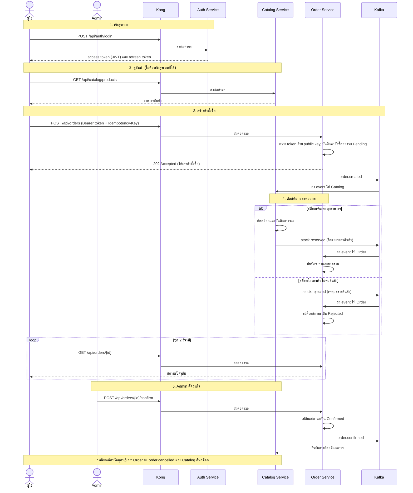

# Sequence Diagram

แผนภาพนี้แสดงเส้นทางหลักของระบบ ตั้งแต่เข้าสู่ระบบ ดูสินค้า สั่งซื้อ จนถึง Admin ยืนยันคำสั่งซื้อ

## คำอธิบายขั้นตอน

1. ผู้ใช้เข้าสู่ระบบกับ Auth Service และได้ token สำหรับใช้เรียกบริการอื่น
2. ผู้ใช้ดูสินค้าจาก Catalog ได้โดยไม่ต้องเข้าสู่ระบบ
3. เมื่อสั่งซื้อ Order Service บันทึกคำสั่งซื้อแล้วตอบกลับทันทีว่ารับเรื่องแล้ว (202) โดยยังไม่รู้ราคาหรือสต็อก เพราะไม่ได้เรียก Catalog โดยตรง
4. Catalog ได้รับ event ไปตัดสต็อก ถ้าสินค้าครบทุกรายการจึงสำเร็จ ถ้ารายการใดไม่พอ ทั้งคำสั่งซื้อจะถูกปฏิเสธ (all-or-nothing) หน้าเว็บสอบถามสถานะทุก 2 วินาทีจนกว่าจะได้ผล
5. Admin ยืนยันหรือปฏิเสธคำสั่งซื้อที่จองสต็อกสำเร็จแล้ว หากถูกปฏิเสธหรือผู้ใช้ยกเลิก ระบบคืนสต็อกให้อัตโนมัติ และหากไม่ได้รับผลจาก Catalog ภายใน 60 วินาที ระบบจะปฏิเสธคำสั่งซื้อนั้นเองและคืนสต็อก
